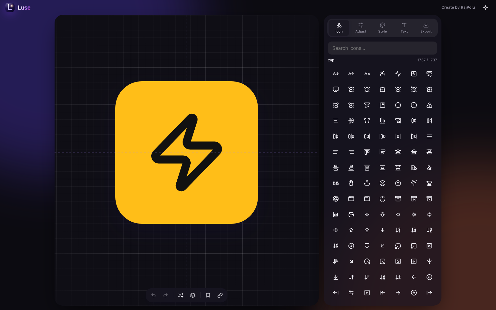

# Luse – Icon Logo Studio

<p align="center">
  
</p>

<p align="center">
  <strong>A fast, lightweight, dependency-free in-browser studio for creating custom app icons, logos, and favicon packages in seconds.</strong>
</p>

<p align="center">
  <a href="https://luseapp.vercel.app"><strong>🌐 Try Live Demo: luseapp.vercel.app</strong></a>
</p>

<p align="center">
  <a href="https://luseapp.vercel.app"></a>
  
  
  
  <a href="https://github.com/Rajpolu/luse/stargazers"></a>
  <a href="https://github.com/Rajpolu/luse/network/members"></a>
  <a href="https://github.com/Rajpolu/luse/issues"></a>
  <a href="LICENSE"></a>
  
  
</p>

---

## 📸 Preview

<p align="center">
  
</p>

---

## 📌 About Luse

> **Short Description**: **Luse** is a client-side icon and logo design studio built with pure **HTML5**, **CSS3**, and **vanilla JavaScript**. It empowers developers, designers, and founders to customize 1,700+ vector icons, fine-tune geometry and typography, preview in real time, and export production assets from favicons up to 4K rasters—instantly in the browser with zero build configuration.

Unlike complex graphics software or subscription-gated tools, Luse requires no account, sends no telemetry, and has zero server dependencies. Everything runs locally in your browser with microsecond responsiveness.

---

## 🔍 Focused SEO Keywords

`logo-maker` · `icon-generator` · `favicon-generator` · `app-icon-creator` · `svg-logo-designer` · `html5` · `css3` · `javascript` · `vanilla-js` · `lucide-icons` · `web-design-tools` · `indie-hacker-tools` · `branding-generator` · `developer-tools` · `open-source`

---

## 💻 Languages & Tech Stack

Luse is deliberately engineered with standard web platform technologies without frameworks, bundlers, or transpilers:

| Technology | Implementation & Purpose |
| :--- | :--- |
| **HTML5** | Semantic document outline, accessible modal dialogs (`aria-*` roles, focus management), embedded responsive SVG vector viewport (`geometricPrecision`), and canvas rendering targets. |
| **CSS3** | Modern responsive layout via CSS Grid & Flexbox, CSS Custom Properties (variables) for dynamic light/dark theming, glassmorphism backdrops, tactile interactive scrubber styles, and 3D perspective transforms. |
| **JavaScript (ES6+)** | Pure vanilla JavaScript application engine managing real-time SVG DOM generation, HSV color math, pointer capture drag handlers, requestAnimationFrame batched rendering, undo/redo state stacks, and HTML5 Canvas rasterization. |
| **Lucide Icons** | Complete offline vector symbol library (1,700+ icons) licensed under ISC. |
| **JSZip** | Fast in-browser ZIP generation for multi-resolution favicon asset packaging. |

---

## ✨ Detailed Features

### 🎨 Icon Library & Customization
- **1,700+ Vector Icons**: Full integration of the complete [Lucide](https://lucide.dev) icon library with instant search, live filtering, and direct links to icon specs.
- **Parametric Geometry**: Fine-tune icon scaling (100–460px), smooth rotation (-180° to +180°), stroke border thickness (0.5–4.0px), and fill opacity (0–100%).
- **Shape Radii**: Toggle between sharp square, squircle (iOS-style corner radius), and circular avatar layouts, or scrub continuous corner radius from 0 to 256px.

### 🌈 Color & Visual Styling
- **Precision Color Engine**: Full HSV color picker with 2D saturation/value plane, continuous hue slider, and direct hex code input.
- **Native EyeDropper API**: Sample any color directly from your desktop screen (on supported Chromium browsers).
- **Curated Palettes & Presets**: Quick-select trending solid swatches and single-click style presets.
- **Dynamic Gradients**: 8 handcrafted linear gradient blends (Sunset, Ocean, Aurora, Grape, Peach, Midnight, Mint, Candy) with customizable gradient rotation angles (0–360°).
- **Transparency Mode**: Instant checkerboard canvas toggle for transparent PNG/SVG exports.

### ✍️ Typography & Layout Engine
- **Three Composition Modes**: Choose between *Icon Only*, *Icon + Text*, or *Text Only*.
- **Auto-Balanced Optical Layout**: Automatic mathematical scaling and vertical positioning to maintain visual harmony between icon and label.
- **6 Typographic Presets**:
  - **Modern** (Inter / System Sans-Serif)
  - **Elegant** (Playfair Display / Serif)
  - **Tech** (JetBrains Mono / Monospace)
  - **Friendly** (Nunito / Rounded Sans)
  - **Impact** (Arial Black / Display)
  - **Script** (Brush & Cursive)
- **Typographic Controls**: Font weights (Regular 400, Bold 700, Black 900), letter-spacing tracking (-10% to +40%), text scaling, and instant uppercase casing.

### 🚀 Production-Grade Export Engine
- **Multi-Format Export**: Download in **SVG** (infinite resolution vector), **PNG**, **WebP**, or **JPG**.
- **High-DPI Resolutions**: One-click rendering in **512px**, **1K (1024px)**, **2K (2048px)**, and ultra-crisp **4K (4096px)** with bicubic smoothing.
- **One-Click Favicon Pack (.zip)**: Bundles a complete web favicon suite containing 16×16, 32×32, 48×48, 64×64, 128×128, 180×180 (Apple Touch Icon), 192×192, 256×256, 512×512 PNGs alongside raw vector `icon.svg` using client-side JSZip.
- **Direct Clipboard Integration**: Copy raw SVG vector markup or binary PNG raster image directly to your clipboard.

### 🛠️ Workflow & Productivity
- **Tactile Scrubber Sliders**: Drag left/right to scrub values, hold <kbd>Shift</kbd> for 0.1x micro-precision, use arrow keys to step, or double-click to type exact numeric values.
- **Undo / Redo History**: Up to 80 action history states accessible via <kbd>Ctrl</kbd>/<kbd>Cmd</kbd> + <kbd>Z</kbd> and <kbd>Ctrl</kbd>/<kbd>Cmd</kbd> + <kbd>Shift</kbd> + <kbd>Z</kbd> (or <kbd>Cmd</kbd> + <kbd>Y</kbd>).
- **Design Bookmarks**: Save up to 24 design iterations locally in your browser’s `localStorage`.
- **Shareable Hash Links**: Encode your full configuration directly into a URL hash (`#d=...`) to share designs without a backend database.
- **Dark & Light Mode**: Seamless theme switching with system preference detection and manual override.
- **Interactive 3D Stage**: Smooth parallax 3D card tilt responding to pointer movement.
- **Mobile & Tablet Optimized**: Responsive bottom-sheet modal with accessible keyboard navigation and focus trapping.

---

## 🚀 How to Use It

### Option 1: Open Directly
Because Luse is entirely self-contained with no build steps, you can simply open `index.html` in any modern web browser:

```bash
# macOS
open index.html

# Linux
xdg-open index.html

# Windows
start index.html
```

### Option 2: Run a Local Static Server
To avoid local file URL limitations and enable full web capabilities (such as the EyeDropper API and clipboard permissions), serve the directory with any static server:

```bash
# Using Python 3
python3 -m http.server 8000

# Using Node.js
npx serve .

# Using PHP
php -S localhost:8000
```
Then open **`http://localhost:8000`** in your browser.

---

## 📖 Quick Start Guide

1. **Pick an Icon**: Navigate to the **Icon** tab and search among 1,700+ Lucide symbols (or click the **Shuffle** button in the bottom toolbar for random inspiration).
2. **Refine Geometry**: Switch to the **Adjust** tab to customize icon size, stroke border width, rotation angle, and background squircle roundness.
3. **Style Colors**: Go to **Style** to pick colors, adjust fill opacity, apply gradients, or select one of the starter presets.
4. **Add Brand Text**: On the **Text** tab, set the mode to *Icon + Text*, enter your brand name, and choose a typography preset.
5. **Export Your Assets**: Open the **Export** tab to download high-resolution PNGs (up to 4K), copy clean SVG code, or generate a complete **Favicon pack (.zip)**.

---

## 📁 Project Structure

```text
luse/
├── index.html            # Main application layout, SEO metadata, and semantic markup
├── css/
│   └── styles.css        # Responsive CSS3 styling, custom properties, and themes
├── js/
│   ├── app.js            # Pure vanilla JavaScript app engine, HSV math, and canvas export
│   └── vendor/
│       ├── lucide.min.js # Lucide Icons v0.460.0 (offline vector icon library)
│       └── jszip.min.js  # JSZip v3.10.1 (client-side favicon ZIP generator)
├── assets/
│   ├── logo.svg          # Luse brand mark
│   ├── favicon.svg       # Studio favicon
│   └── screenshot.png    # High-resolution retina preview
├── LICENSE               # MIT License
└── README.md             # Documentation, SEO keywords, and guides
```

---

## 🤝 Contributing Guidelines

Contributions, ideas, and bug reports are welcome! To contribute:

1. **Fork the Repository** on GitHub.
2. **Clone your fork**:
   ```bash
   git clone https://github.com/your-username/luse.git
   cd luse
   ```
3. **Create a Feature Branch**:
   ```bash
   git checkout -b feature/amazing-feature
   ```
4. **Make Your Changes**:
   - Keep the application dependency-free, lightweight, and performant.
   - Maintain pure vanilla JavaScript (no framework runtime) and clean CSS3.
   - Test across modern browsers (Chrome/Brave, Firefox, Safari) and mobile viewport sizes.
5. **Commit Your Changes**:
   ```bash
   git commit -m "feat: add amazing feature"
   ```
6. **Push to Your Fork**:
   ```bash
   git push origin feature/amazing-feature
   ```
7. **Open a Pull Request** describing what you added or fixed.

---

## 📄 License

This project is licensed under the **[MIT License](LICENSE)** – created by [Rajpolu](https://github.com/rajpolu).

### Third-Party Credits
- **[Lucide Icons](https://lucide.dev)** – [ISC License](https://github.com/lucide-icons/lucide/blob/main/LICENSE)
- **[JSZip](https://stuk.github.io/jszip/)** – [MIT License](https://github.com/Stuk/jszip/blob/master/LICENSE.markdown)
